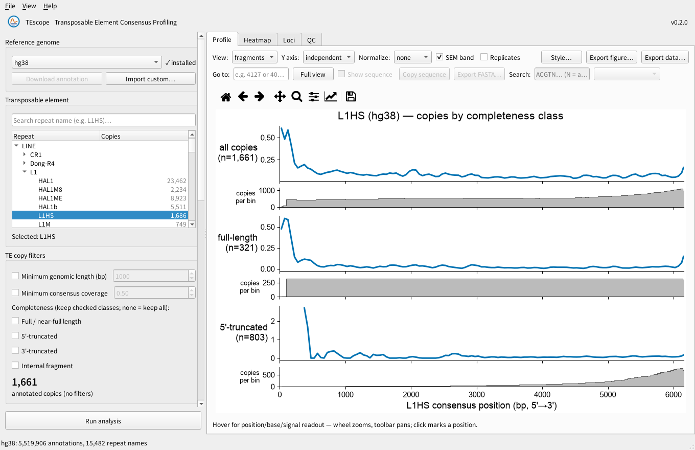
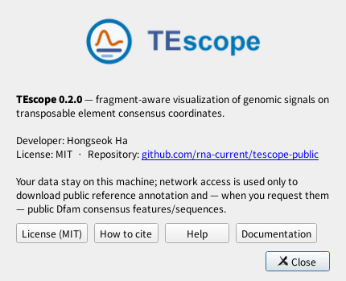
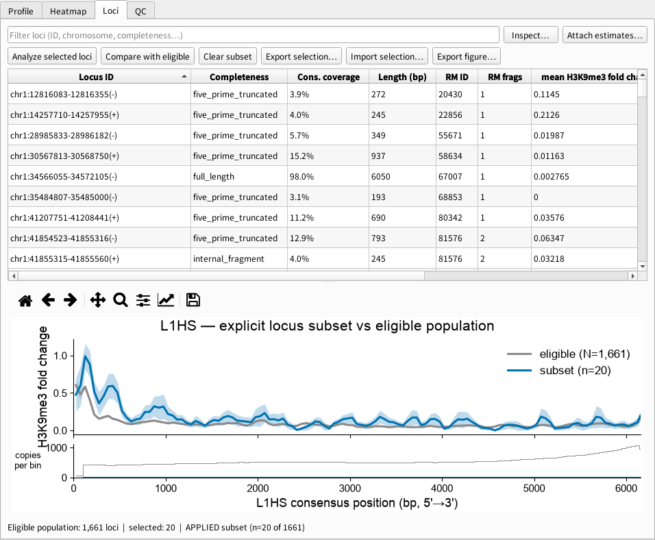
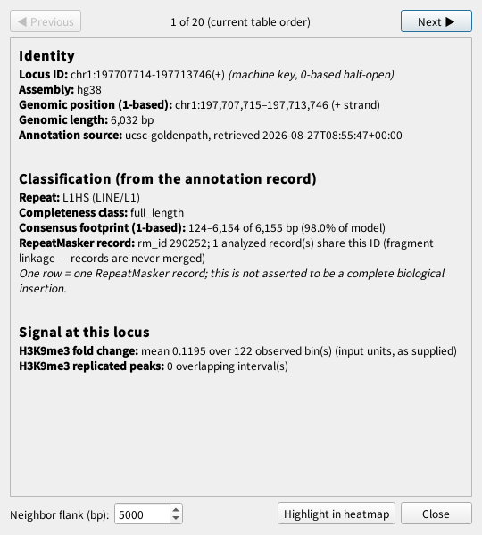
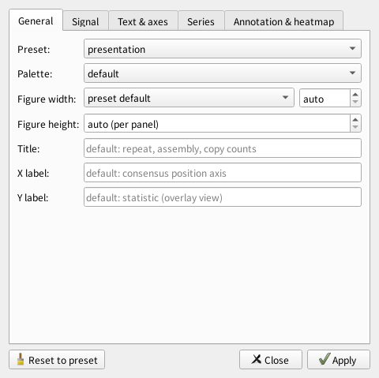

# TEscope User Guide — complete control reference

Documented version: **TEscope 0.2.0** (verified on the 0.2.0rc2 candidate; 0.2.0 differs from it only in the version string and the repository URL; every behavior below was
verified against the application code and the running GUI of this
version; nothing is inferred from a control's name). Coordinates in
every on-screen readout are **1-based inclusive**; the single
exception is the user-feature table, which is **0-based half-open**
and labeled as such. "Analysis" in the *Effect* column means the
setting is only read when you press **Run analysis** (and by *Save
project…*); "Display" means it takes effect immediately.

## 1. Main window

- Title bar: `TEscope <version>`; window/taskbar icon = profile-lens
  symbol. Default size 1280×820; drag the splitter between the left
  column and the results to resize (sidebar minimum 400 px; the
  sidebar scrolls vertically when panels don't fit).
- Header strip: logo, **TEscope**, subtitle *Transposable Element
  Consensus Profiling*, version at the right.
- **Drag & drop** anywhere on the window: local signal files are added
  as tracks; each unsupported file shows an "Unsupported file" warning
  naming the exact problem.
- Status bar (bottom): the message starts as `Ready` and is color-
  tinted — accent while running, green on success (`L1HS:
  1,661/1,661 copies analyzed`), amber when the run produced notes
  (`… — 2 note(s), see QC tab`), red on error. A slim progress bar
  appears on the right during downloads and analyses.

### 1.1 Menus (no keyboard accelerators; Alt+F/V/H mnemonics only)

| Menu item | What it does |
|---|---|
| File ▸ **Open project…** | Opens a saved configuration (`*.yaml *.yml *.json`). Restores assembly, repeat selection, filters (including fields without widgets, e.g. strand restriction), tracks (including per-track options without widgets), Y-axis/Normalize/SEM/Replicates toggles, plot style, annotation and sequence settings. The **View:** mode (stacked/overlay/fragments) is a session display choice and is not stored in projects. You still press **Run analysis** to compute. Errors open "Cannot open project". |
| File ▸ **Save project…** | Validates the current settings first — an invalid setup shows "Incomplete project" and no file dialog opens. Default name `analysis.yaml`. The file reproduces the analysis headlessly (`tescope run analysis.yaml`). |
| File ▸ **Quit** | Closes immediately; there is no unsaved-changes prompt — save your project first. |
| View ▸ Theme ▸ **Light / Dark / System** | Application theme (persisted between sessions; the only persisted preference). *System* follows the OS color scheme where Qt can detect it, otherwise light. Exported publication figures are never affected by the app theme. |
| Help ▸ **About TEscope** | Version, Developer: Hongseok Ha, license/repository, privacy statement, and resource buttons (License, How to cite, Help, Third-party notices, Documentation) — each button appears only when its file is actually available in your installation. |

## 2. Reference genome panel

| Control | Behavior | Default / values |
|---|---|---|
| Assembly combo | Pick the annotation assembly. Items: `hg38`, `hg19`, `mm39`, `mm10` plus any custom assemblies you imported; not-yet-downloaded entries show as `name (not downloaded)`. Changing assembly clears the TE tree and the live filter counts; a previously selected repeat must be re-chosen (stale selections cannot leak across assemblies). | first entry |
| `✓ installed` / `not installed` | Read-only install status of the selected assembly. | — |
| **Download annotation** | Fetches the public RepeatMasker annotation for the selected assembly (network required once; progress shows percent during download). Disabled when the assembly is already installed or none is selected. On failure the exact error opens in "Reference installation failed". | — |
| **Import custom…** | Pick a RepeatMasker `.out(.gz)` / UCSC rmsk table, then name the assembly (empty name cancels silently). The custom assembly then appears in the combo and behaves like a built-in. | filter: `RepeatMasker output (*.out *.out.gz *.txt *.txt.gz)` |

## 3. Transposable element panel

| Control | Behavior |
|---|---|
| Search field (`Search repeat name (e.g. L1HS)…`) | Case-insensitive **literal substring** filter on the repeat (subfamily) name only — no wildcards, class/family names are not searched. A non-empty query auto-expands the tree. |
| Repeat tree (`Repeat` / `Copies`) | Three levels: class ▸ family ▸ subfamily; copy counts on leaves only. **Selecting a class or family row selects nothing** — only a leaf (subfamily) drives the analysis. Selecting a leaf immediately loads its copies, updates the live filter counts, and refreshes the Dfam/sequence status lines. |
| `Selected: <name>` / `No repeat selected` | Read-only confirmation of the active selection. |

## 4. TE copy filters panel

All filter edits update the **live count preview instantly** (no run
needed for the preview); the plots/exports change only after **Run
analysis**. With a repeat selected, the big number is exactly what the
next run will analyze, with the per-step breakdown underneath (e.g.
`Length >= 1 kb`, `Consensus coverage >= 50%`, `Completeness: full
length`).

| Control | Behavior | Default / range |
|---|---|---|
| `Minimum genomic length (bp)` + spin | Keep copies whose genomic footprint is at least N bp. The spin is disabled until the checkbox is on. | off; 1000 bp (1–1,000,000) |
| `Minimum consensus coverage` + spin | Keep copies covering at least this **fraction of the consensus model**. | off; 0.50 (0.00–1.00, step 0.05) |
| Completeness checkboxes: `Full / near-full length`, `5'-truncated`, `3'-truncated`, `Internal fragment` | Keep only the checked classes; **none checked = keep all**. Classes are geometric: an end counts as "reached" within a tolerance of max(5% of the model, 20 bp). | all unchecked |

Project files can additionally restrict strand, exclude RepeatMasker
secondary (`*`) hits, or change the end tolerances; these have no
widgets but round-trip faithfully through Open/Save project.

## 5. Consensus features panel

Annotation never changes any number — it attaches labeled intervals
to plots and exports.

| Control | Behavior | Default |
|---|---|---|
| `Annotate consensus features` | Enables the feature layer for the next run (Dfam database features and/or your table below). | off |
| Status line | Cache-only Dfam state for the selected repeat, e.g. `Dfam DF000000225 (3.8): verified, 3 feature(s), cached.`, `Dfam (3.8): incompatible consensus — features withheld.`, `Dfam: not checked yet — features will be looked up on Run when annotation is enabled.` | `No repeat selected` |
| **Check Dfam…** | Queries the Dfam API now (network) and caches the result; disabled with no repeat selected or while a check runs. Failures show in the status line. There is no force-refresh control; the cache is reused. | — |
| User-feature table (`Name/Start/End/Label`) | Your own consensus intervals, **0-based half-open** (stated in the caption). All cells editable. Invalid rows block Run/Save with `User feature table: row N: …` messages (missing fields, non-integer coordinates, end ≤ start, negative start, empty name). | empty |
| **Add** / **Remove** | Insert an empty row / delete the selected rows. | — |
| **Import…** | Append features from a `*.tsv *.yaml *.yml *.json` file (bad files show "Import failed"; existing rows are kept). | — |
| `Show in plots` | Draw the feature lane (and optional shading, see Style) in figures. User features always keep a hatch + lane label so they can never be mistaken for database annotations. | on |
| `Feature files:` line + **Add feature file…** / **Clear** | Attach whole feature FILES (template TSV, BED, GFF3 — see `docs/feature-import.md`): consensus-target files join the user lane; genome-target files appear in the Locus Inspector. The file is fully validated first and a preview (target, reference, coordinate convention, feature count, warnings) must be confirmed before it is attached; **Clear** detaches all files. Malformed or incompatible files fail the Run with every validation error listed. Amino-acid coordinates are rejected (no ×3 conversion). BED is read 0-based half-open and GFF3 1-based inclusive **by their specifications** — never guessed. | none |

## 6. Consensus sequence panel

Sequence display is optional, never required to run, and never
changes numbers. Compatibility with the analysis' consensus model is
verified (exact name/alias + exact model length) before any base is
shown; **that gate is a compatibility check, not proof of sequence
identity**.

| Control | Behavior | Default |
|---|---|---|
| `Attach consensus sequence` | Enables sequence resolution on the next run. | off |
| `Source:` combo | `Automatic (Dfam)` / `User-provided library…` / `User-provided FASTA…` / `None`. User files are read locally in place — never copied or redistributed; their license terms remain your responsibility. | Automatic (Dfam) |
| **Browse…** | Pick the local FASTA/library (`*.fa *.fasta *.fa.gz *.fasta.gz`); enabled only for the two user-provided sources. The chosen path shows beneath. | disabled |
| Status line | Local/cache-only resolution state, e.g. `Verified: … — provider dfam (3.8)`, `incompatible: …`, `Choose a local FASTA/library file (Browse…).` | `No repeat selected` |
| **Check source…** | Resolves now (network allowed for Dfam) and caches; disabled with no repeat, source `None`, or a user source without a chosen file. | — |

## 7. Signal tracks panel

Add files by **Add…**, or drag & drop onto the window. Accepted:
bigWig (`.bw/.bigWig`), bedGraph (`.bedGraph/.bg/.bdg`), BED /
narrowPeak / broadPeak, BAM/CRAM; `.gz` accepted for the text
formats. Unsupported files are reported with the exact reason.

Table columns (click selects the whole row; **Up/Down** reorder rows
= panel order in figures; **Remove** deletes selected rows):

| Column | Editing | Meaning |
|---|---|---|
| `Name` | editable | Display name (tooltip shows the full file path). Duplicate name+kind pairs are rejected at Run. |
| `Kind` | read-only | Sniffed `continuous` / `interval` / `point` with a small type icon. |
| `Group` | editable | Tracks sharing a group are combined into ONE plotted series (mean of members) with a between-replicate SEM band, plus their own `group_*` export table. |
| `Rep` | editable | Replicate number (digits only; anything else means "no replicate"). Replicates can be overlaid individually with the Profile tab's `Replicates` checkbox. |
| `Mapping` | combo, capability-gated | `all reads` / `unique (NH=1)` / `multi (NH>1)` / `unique (MAPQ)`. **This changes the analyzed observation set.** The combo is enabled only for BAM/CRAM; NH choices additionally require NH tags in the file (probed from the first 200 reads). Disabled items carry the exact reason as a tooltip (pre-aggregated signal; no NH tags; pysam unavailable — BAM support is unavailable on Windows builds). `multi` is NH-only: MAPQ cannot positively identify multi-mappers. |
| `Show` | checkbox | Unchecked tracks are analyzed but get no figure panel and no cursor readout. |

Per-track options without widgets (config/CLI only, round-tripped by
projects): `strand` (BAM only), `min_mapq`, `exclude_duplicates`,
`unique_mapq`, `sample`, `color`.

There is intentionally no GUI control for `aggregation.bin_size`
(default 10 bp) or `statistic` (mean) — set them in the project file;
both are reported in the QC tab.

## 8. Run analysis

The accent-colored button under the sidebar. It first validates the
whole setup — problems open "Cannot run" with the precise message
(missing assembly/repeat/tracks, duplicate names, invalid mapping
request, bad user-feature row, missing sequence file, invalid style
value, annotation not downloaded). The run executes on a worker
thread with live progress; on success the status bar reports
`{repeat}: {selected:,}/{annotated:,} copies analyzed` (+ a note
count pointing at the QC tab when applicable); on failure the error
opens in "Analysis failed" (internal errors include a short
traceback). The button is disabled only while a run is in flight;
repeated runs replace the previous result cleanly.

## 9. Results — Profile tab

Top row (all **display-only**, instant):

| Control | Values (default bold) | Notes |
|---|---|---|
| `View:` | **stacked** / overlay / fragments | `fragments` renders the all / full-length / 5'-truncated comparison with per-subset support panels. Session-only; not stored in projects. |
| `Y axis:` | **independent** / shared | Shared puts all continuous panels on one scale. |
| `Normalize:` | **none** / zscore / minmax | **Display-only** rescaling of the drawn curve; exported tables are never normalized. |
| `SEM band` | **on** | Shaded uncertainty-of-the-mean band. |
| `Replicates` | **off** | Additionally draw each replicate thinly behind its group mean. |
| `Style…` | — | Opens the Figure style dialog (needs a result first — it says so). |
| `Export figure…` / `Export data…` | — | See §13. Silently inactive before the first run. |

Browser row (works on the current result):

| Control | Behavior |
|---|---|
| `Go to:` | A 1-based position (`4127`) or range (`4000-4500`; `:` and thousands commas also accepted). A single position opens a ±40 bp window. Errors appear in the readout line, not a dialog. |
| `Full view` | Whole consensus (same as the toolbar Home). |
| `Show sequence` | Toggles the aligned sequence track; letters render only when the window is ≤400 bp AND ≥7 px/base. |
| `Copy sequence` | Copies the visible region as FASTA to the clipboard (confirmation in the readout line). |
| `Export FASTA…` | Full consensus or the visible region (it asks when zoomed); the FASTA header carries family, provider/accession, release, 1-based positions, length and a source checksum prefix. |
| `Search:` | Case-insensitive **literal** match on the forward strand; `N` matches any base; other IUPAC letters are accepted but match only literally. Hits fill the combo as 1-based ranges (`500 max`); choosing one zooms to it; the first hit zooms automatically. |

Sequence controls stay visible but **disabled with an explanatory
tooltip** whenever exact-coordinate display isn't justified: no source
configured, resolution not attempted, or the available sequence is
incompatible with this analysis' consensus model.

Mouse & keyboard on the plot:

- **Wheel** zooms about the cursor (×1.25 per notch; minimum window
  10 bp); **left-click** drops a position marker across all panels
  (suppressed while pan/zoom tools are active); **hover** drives the
  readout line: `base 113 (1-based) | <track>: 0.585 | copies: 451 |
  feature: 5'UTR`, up to three tracks and two features.
- Matplotlib toolbar: Home/Back/Forward, Pan (left drags, right
  zooms), box Zoom, Subplots, Save. Since 0.2.0, the toolbar's Save
  goes through TEscope's export path and **writes the `.figure.json`
  provenance sidecar** like `Export figure…` (PNG/SVG/PDF dialog).
  With the canvas focused, matplotlib's default keys apply
  (`p` pan, `o` zoom, `h` home, `g` grid, `l`/`k` log axes…); the
  grid/log keys change the on-screen look outside TEscope's style
  system and are not saved anywhere.

## 10. Results — Heatmap tab

| Control | Behavior |
|---|---|
| `Track:` | One entry per continuous track that has a per-copy matrix (grouped tracks have none). Empty until a qualifying run. |
| Heatmap | Copies × bins; row order and color limits come from the Style dialog (`Row sort` is row ORDER only; color limits are display-only — never normalization). |
| `Export heatmap…` | PNG/SVG/PDF with the provenance sidecar; errors open "Export failed". |

## 11. Results — Loci tab

One row per analyzed TE copy (one RepeatMasker record — the `RM
frags` column shows how many analyzed records share the same
RepeatMasker ID; records are never merged). Browsing, filtering,
sorting, and selecting here change **nothing** analytically: only the
two explicit actions below compute anything, and the eligible
population's aggregates are never touched.

| Control | Behavior |
|---|---|
| Filter box | Case-insensitive substring filter across all columns (hides rows; display-only). |
| Table | Sortable by any column (numeric sort on raw values). Multi-select rows (Ctrl/Shift). Cells showing `unavailable` mean missing/unsupported evidence — explicitly **not** an observed zero (tooltip explains). `Locus ID` is the stable machine key `chrom:start-end(strand)`, **0-based half-open** (the one 0-based display, labeled; used by selection and estimate files). |
| **Analyze selected loci** | EXPLICIT action: aggregates only the selected loci (≥ 2), recomputed from the original per-copy values — no re-projection, no re-estimation, no reassignment. Draws the subset-only figure below. |
| **Compare with eligible** | Same, but overlays the eligible population's unchanged aggregate; the legend always carries both denominators (`eligible (N=…)` / `subset (n=…)`). |
| **Clear subset** | Removes the applied subset (selection remains). |
| **Export selection…** / **Import selection…** | Reproducible selection files (`tescope-locus-selection/1` YAML: IDs + assembly + repeat + annotation provenance). Import reports every ID that is not in the current eligible population instead of silently dropping it; a different assembly is refused. |
| **Attach estimates…** | Attach an upstream per-locus estimate table (`tescope-locus-estimates` TSV, `docs/feature-import.md`). Adds `estimate …` columns with the declared units/assay. Table context only: estimates are **never drawn as positional signal**, a declared total that includes unique evidence is never added to its unique component, a missing unique column is *unavailable* (not zero), and selecting loci never re-fits or reassigns anything. Assembly mismatches are refused. |
| **Export figure…** | Saves the subset-comparison figure (PNG/SVG/PDF + provenance sidecar). |
| **Inspect…** / double-click | Opens the Locus Inspector on the focused locus. |
| Status line | Always shows: eligible N, selected count, applied-subset state (`no subset applied — selection changes nothing until applied`), invalid saved IDs, and attached-estimate semantics. |

Saved projects persist the selection, the applied-subset flag, and
the estimates file; re-running restores them, and IDs no longer in
the eligible population are listed, never silently adapted. The CLI
writes the same subset tables (`subset_profile_*`/
`subset_occurrence_*`) from the same config.

## 12. Locus Inspector

A non-modal window on one locus; everything in it is display-only.

| Control | Behavior |
|---|---|
| **◀ Previous / Next ▶** | Steps through the Loci table's current (sorted/filtered) order; `k of N` shows the position. |
| Identity | Stable ID (labeled 0-based), assembly, **1-based** genomic position and strand, genomic length, annotation source + retrieval date. |
| Classification | Repeat class/family/name, completeness class, 1-based consensus footprint + % of model, RepeatMasker rm_id + fragment linkage, and the explicit caveat that one row = one annotation record, not a proven complete insertion. |
| Signal at this locus | Per continuous track: the copy's mean over observed bins (input units, as supplied) or "no observed data (missing — not a measured zero)". Per interval track: overlapping-interval count, or "unavailable" when the track lacks the chromosome. Upstream estimates show native units/assay/tool, the never-added unique component (or "unavailable (not zero)"), and native score semantics. |
| Consensus features on this locus | Every consensus feature with its projection onto this copy: `projected to chrom:a–b` (affine within the RepeatMasker hit endpoints — labeled **not gap-aware or base-accurate**), `(partial — feature extends beyond this copy)`, or `outside this copy's consensus footprint — no verified correspondence` (nothing is drawn/claimed for that part). Reverse-strand loci project correctly (consensus 5' maps to the genomic end). |
| `Neighbor flank (bp)` | Display-only window (default 5,000) for listing user-supplied genome-target features near the locus, with distances; absence is labeled as absence *from the supplied file*, not biological absence. |
| **Highlight in heatmap** | Switches to the Heatmap tab and draws a display-only marker on this locus's row (no value or order changes). |

Feature annotation/projection never proves an intact ORF, a
functional domain, or an active element.

## 13. Results — QC tab

A read-only table (`Section/Metric/Value`): assembly/repeat/model
length/bins; annotation source + retrieval date + md5; every filter
step with counts; completeness/strand breakdowns; per-bin coverage
summary; one section per track (file, group/replicate, chromosomes,
**mapping policy or the reason none is available**, skipped copies,
missingness, the BAM multimapper caveat, peak counts); genome
feature files; locus-estimate semantics (tool/assay/units, whether
the total includes unique evidence, match report); the applied
subset (selected/eligible counts). Run notes referenced by the
status bar appear here.

## 14. Figure style dialog

Edits apply to the current figures instantly on **Apply** (no re-run,
ever); invalid values pop "Invalid style" with the exact field.
**Reset to preset** discards all style edits including per-series
colors. **Close** keeps whatever was last applied.

- **General**: Preset (**screen** / publication / publication_minimal
  / presentation / high_contrast / custom — see docs/plot-style.md),
  Palette (default Okabe-Ito / colorblind / grayscale with automatic
  line-style cycling), figure width (auto / single-column ~8.5 cm /
  double-column ~17.8 cm / custom 0–60 cm) and height (auto per
  panel), Title / X label / Y label overrides.
- **Signal**: Representation (line / **filled** with `Fill alpha`),
  Smoothing (none / moving_average / gaussian / savgol with window
  [odd, 3–201] / sigma [0.1–50 bins] / order [1–9]) — **display-only;
  exported tables stay raw**, smoothed values export separately as
  `profile_smoothed_*`; `Show raw profile under smoothed` (on); Band
  (**sem** / iqr / none) — *sem* = uncertainty of the mean, *iqr* =
  variation **across TE copies** (25–75% + optional 10–90% outer
  ribbon), available only when an UNGROUPED continuous track provides
  a per-copy matrix (the item is otherwise disabled with that
  explanation); feature-region shading; "Also export
  fragment-comparison figure". The nine signal controls disable
  together, with an explanation, when the analysis has no continuous
  track. Smoothing/iqr choices add tables to the next `Export data…`.
- **Text & axes**: five font-size overrides (0 = preset), legend
  on/off + position (best/corners/outside right), grid + alpha, and
  **display-only** Y range / X window edits ("view windows only — no
  data are filtered or transformed").
- **Series**: one row per plotted series — color swatch + hex field
  (hex wins; empty = palette; saved colors are never reassigned),
  line style (preset/solid/dashed/dotted/dashdot), width (preset or
  0.1–8 pt).
- **Annotation & heatmap**: annotation lane alpha/border, database
  and user lane colors (user lane always keeps its hatch + label),
  heatmap colormap (viridis/magma/cividis/Greys/RdBu_r/coolwarm),
  color limits (display-only), colorbar toggle, row sort
  (cons_start/genome_length/consensus_coverage/total_signal), and an
  optional aggregate profile panel above the heatmap.

## 15. Exports and files

| Action | Formats | Output |
|---|---|---|
| Export figure… / Export heatmap… | PNG / SVG / PDF (a typed extension wins; otherwise the selected filter decides) | the image **plus `<name>.figure.json`** — a provenance sidecar with the TEscope version, the full configuration, and annotation/sequence provenance, enough to regenerate the figure. |
| Export data… | directory of TSVs | `profile_*`, `group_*`, `occurrence_*`, `projected_intervals_*`, `points_*`, plus `profile_smoothed_*` (when smoothing is on), `profile_quantiles_*` (iqr band), `mapping_support` (unique+multi BAM pair), `features` + `features_used.json`, `loci` (per-locus table: stable IDs, copy_idx join key, per-track per-locus summaries, est_* columns), `genome_features_*` (echo of attached genome-target files), and `subset_profile_*`/`subset_occurrence_*` + `subset_invalid_ids.txt` when a subset is applied in the config. Raw values are always among the exports. |
| Export FASTA… / Copy sequence | FASTA | provenance-bearing header (see §9). |
| Save project… | YAML/JSON | one file that reproduces the analysis (`tescope run file.yaml`). |

Typography in exports follows the Arial-first policy (Arial →
Liberation Sans → DejaVu Sans…): PDF embeds the resolved font; **SVG
keeps text as text**, so an SVG opened on another machine renders
with that machine's best match for the declared chain — appearance is
not guaranteed identical across systems.

## 16. Offline use and networking

Network is used only for: assembly annotation download (once per
assembly), and Dfam feature/sequence lookups you request. Everything
else — including previously downloaded references and caches — works
offline. Your signal data never leave the machine.
